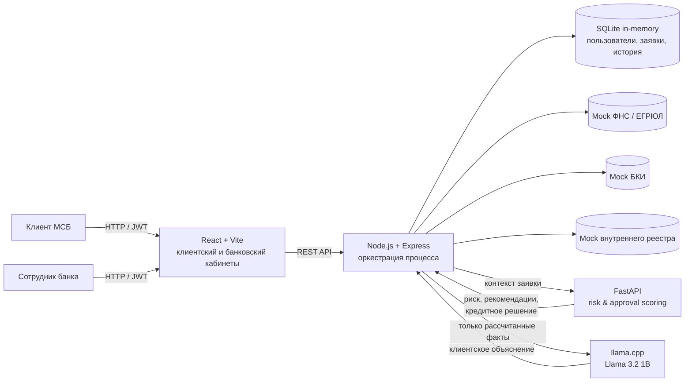
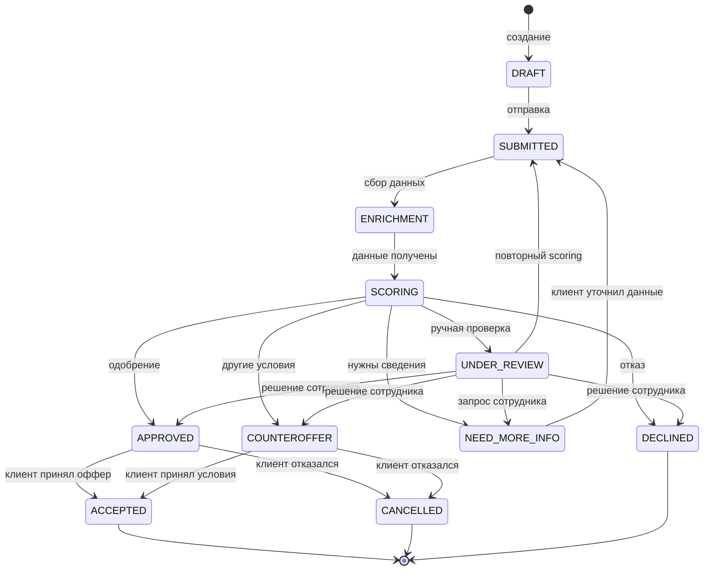
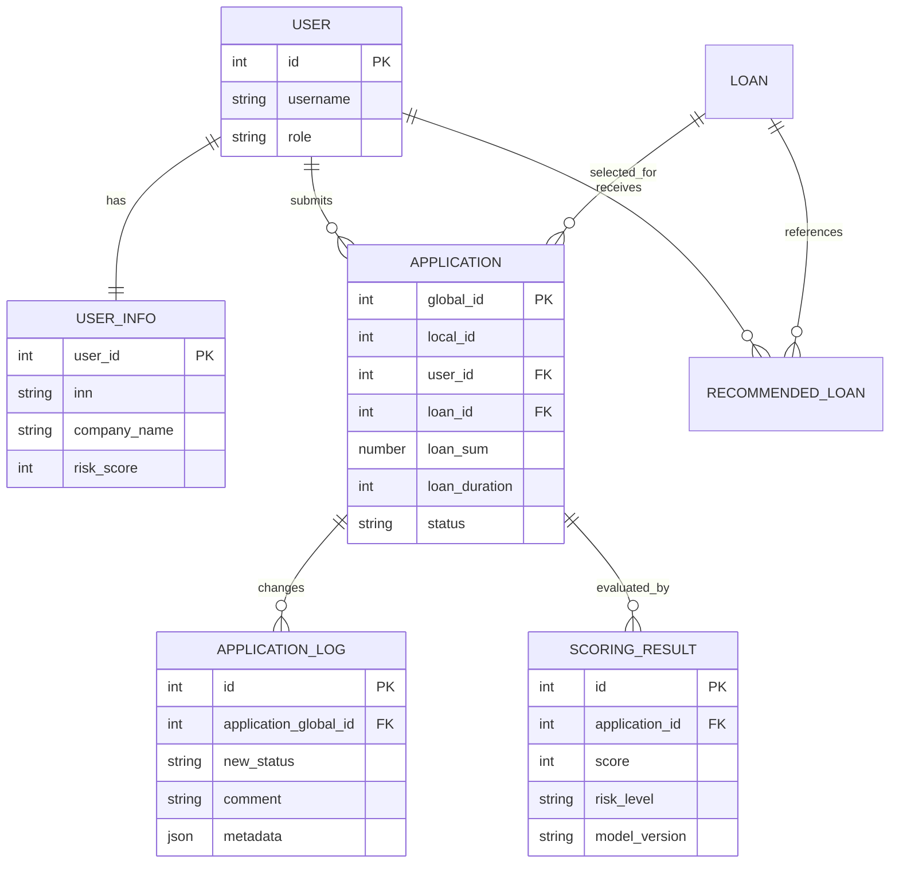

# Alfa Business Credit Flow

Прототип цифрового кредитного конвейера для малого и микробизнеса, подготовленный для хакатона Альфа-Банка 2026.

Решение объединяет клиентский путь и внутреннюю обработку заявки: предприниматель описывает потребность в финансировании, получает подходящие продукты, отправляет заявку и отслеживает её состояние; банк обогащает данные, оценивает риск и формирует одно из четырёх решений — одобрение, встречное предложение, запрос сведений или отказ.

> Версия для проверки: **`v1.0.1-hackathon`**. Клиентский и банковский кабинеты, кредитный конвейер, scoring, синтетические источники, OpenAPI и Docker Compose объединены в один воспроизводимый сценарий.

## Содержание

- [Что требуется решить](#что-требуется-решить)
- [Концепция продукта](#концепция-продукта)
- [Что реализовано](#что-реализовано)
- [Архитектура](#архитектура)
- [Кредитный процесс](#кредитный-процесс)
- [Скоринг и принятие решения](#скоринг-и-принятие-решения)
- [Технологии](#технологии)
- [Быстрый запуск](#быстрый-запуск)
- [Тестовые учётные записи](#тестовые-учётные-записи)
- [Сценарий проверки](#сценарий-проверки)
- [API](#api)
- [Данные и интеграции](#данные-и-интеграции)
- [Тестирование](#тестирование)
- [Материалы для проверки](#материалы-для-проверки)

## Что требуется решить

Задача хакатона — не просто сделать форму кредитной заявки. Необходимо показать **единый управляемый процесс** от возникновения потребности клиента до результата по заявке.

Минимально убедительное решение должно доказать пять вещей:

1. Клиент без банковской экспертизы понимает, какой продукт подходит его задаче.
2. Введённые данные сохраняются и не запрашиваются повторно без причины.
3. Заявка проходит прозрачные этапы, а клиент видит статус и следующее действие.
4. Банк получает данные из нескольких источников, оценивает риск и может обработать нестандартный случай.
5. Эксперт способен воспроизводимо запустить систему и самостоятельно пройти сквозной сценарий.

Для MVP не требуется воспроизводить весь промышленный банковский процесс. Решение фокусируется на связанном контуре от подбора продукта до решения и действия клиента, а внешние интеграции воспроизводятся на синтетических данных.

## Концепция продукта

### Проблема клиента

Предприниматель знает бизнес-задачу — например, нужно пополнить оборотные средства или купить оборудование, — но не обязан понимать продуктовую линейку банка и внутреннюю логику кредитования. Разрозненные анкеты, повторный ввод сведений и непрозрачный статус увеличивают число незавершённых заявок.

### Проблема банка

Банку необходимо одинаково обрабатывать большой поток заявок, собирать сведения из внутренних и внешних источников, объяснимо оценивать риск, автоматически решать типовые случаи и передавать спорные ситуации сотруднику без потери контекста.

### Предлагаемое решение

Alfa Business Credit Flow строится вокруг одной заявки и одного набора данных:

- клиент указывает цель, сумму, срок и ИНН;
- система проверяет компанию и автоматически подбирает подходящие продукты;
- скоринг рассчитывает риск, предварительный лимит, платёж и вероятность одобрения;
- локальная LLM переводит только уже рассчитанные факты в понятное объяснение;
- заявка и история её статусов доступны участникам процесса;
- кредитная политика возвращает `APPROVE`, `COUNTEROFFER`, `REQUEST_INFO` или `DECLINE`;
- клиент видит результат, дополняет сведения или принимает предложение.

Ключевой принцип: **числовое решение принимает детерминированная и версионируемая модель, а LLM не влияет на одобрение кредита**.

## Что реализовано

| Возможность | Реализация |
|---|---|
| Ролевая аутентификация | JWT и роли `CLIENT` / `EMPLOYEE` |
| Личный кабинет клиента | заявки, предложения, карточка и таймлайн |
| Умный подбор финансирования | цель, сумма, срок, ИНН и данные бизнеса |
| Обогащение данных | синтетические ФНС, БКИ и внутренний реестр банка |
| Объяснимый scoring | балл риска, уровень, факторы, стоп-факторы и версия правил |
| Кредитное решение | одобрение, контроффер, запрос сведений или отказ |
| Повторное рассмотрение | уточнение данных создаёт новую версию scoring |
| Кабинет сотрудника | очередь, поиск, фильтры, профиль, факторы и ручное решение |
| Локальное AI-объяснение | Llama 3.2 переформулирует рассчитанные факты для клиента |
| Аудит процесса | история переходов и версии результатов scoring |
| Контракт API | OpenAPI 3.1 и готовая HTTP-коллекция |
| Воспроизводимый запуск | единый `docker compose up --build` |

## Архитектура



### Ответственность компонентов

| Компонент | Ответственность | Порт |
|---|---|---:|
| `frontend` | клиентский кабинет, подбор продукта, карточка заявки и кабинет сотрудника | `5173` |
| `backend` | аутентификация, роли, заявки, продукты, история, интеграции и оркестрация | `5003` |
| `scoring` | валидация, признаки, риск-скоринг, продуктовый скоринг и policy decision | `8000` |
| `llm` | понятное текстовое объяснение уже рассчитанной рекомендации | `8081` |

## Кредитный процесс

### Границы MVP

Процесс начинается с выбора потребности в финансировании и заканчивается решением банка и принятием предложения клиентом. Подписание юридических документов, выдача денег, мониторинг после выдачи, взыскание и бухгалтерский учёт в MVP не входят; выдача после принятия оффера считается смоделированной.

### Участники

- **Клиент** — выбирает потребность, подаёт заявку, дополняет сведения, отслеживает статус и принимает предложение.
- **Система** — валидирует, обогащает данные, рассчитывает риск, ведёт историю и формирует рекомендации.
- **Сотрудник банка** — рассматривает пограничные случаи, запрашивает сведения и подтверждает решение.
- **Технический ML-пользователь** — передаёт автоматическое решение scoring-сервиса в backend с ролевой авторизацией.

### Состояния заявки

Статусы заявки отделены от решений scoring и сотрудника. Канонический словарь используется frontend и backend совместно.



Каждый переход автоматически записывается в историю. Повторная оценка не перезаписывает предыдущий результат, а создаёт новую версию в `scoring_results`.

## Скоринг и принятие решения

Сервис не выдаёт сложную эвристическую формулу за обученную ML-модель. Это прозрачный rule-based scorecard, подходящий для демонстрации бизнес-логики и объяснимости на синтетических данных.

### Источники признаков

- ФНС / ЕГРЮЛ: статус, дата регистрации, организационная форма, ОКВЭД и сведения о МСП;
- БКИ: число кредитов, долг, ежемесячный платёж, просрочки и дефолт;
- внутренний контур: обороты, расходы, эквайринг, срок отношений с банком, 115-ФЗ и история продуктов;
- заявка: цель, сумма, срок, заявленная выручка и продукт.

### Логика оценки

1. Входные данные проходят схемную и логическую валидацию.
2. Из источников строятся нормализованные признаки.
3. Risk scorecard формирует балл `0–999`, уровень `LOW` / `MEDIUM` / `HIGH`, факторы и стоп-факторы.
4. Для каждого продукта рассчитываются eligibility, предварительный лимит, платёж, долговая нагрузка и эвристическая вероятность одобрения.
5. Кредитная политика выбирает результат:
   - `DECLINE` — сработал стоп-фактор или риск вне политики;
   - `REQUEST_INFO` — отсутствуют критичные сведения;
   - `APPROVE` — низкий риск и вероятность не ниже `0.75`;
   - `COUNTEROFFER` — риск не высокий и вероятность не ниже `0.40`, но условия корректируются лимитом.

Конфигурации версионируются отдельно:

- `ml/artifacts/risk_scorecard_v1.json` — `risk_scorecard_v1.0.0`;
- `ml/artifacts/approval_policy_v1.json` — `approval_rules_v1.0.0`.

> `default_probability` и `approval_probability` являются демонстрационными эвристиками, не откалиброваны на реальном кредитном портфеле и не предназначены для промышленного кредитного решения.

## Технологии

- **Frontend:** React 19, React Router 7, Vite 8, Nginx.
- **Backend:** Node.js 24, Express 4, JWT, bcryptjs, встроенный `node:sqlite`.
- **Scoring:** Python 3.11, FastAPI, Uvicorn, dataclasses, pytest/unittest.
- **LLM:** llama.cpp server, `Llama-3.2-1B-Instruct-Q4_K_M.gguf`, CPU-only режим.
- **Инфраструктура:** Docker, Docker Compose.

Версии npm-зависимостей зафиксированы в `package-lock.json`, `backend/package-lock.json` и `frontend/package-lock.json`. Версия Python и диапазоны зависимостей зафиксированы в `ml/pyproject.toml`.

## Быстрый запуск

### Требования

- Docker Desktop с Docker Compose v2;
- не менее 4 ГБ свободной оперативной памяти;
- свободные порты `5173`, `5003`, `8000`, `8081`;
- около 1 ГБ места для GGUF-модели.

### 1. Подготовить окружение

Из корня репозитория:

```powershell
Copy-Item .env.example .env
```

Для локального демо значения из `.env.example` можно оставить без изменений. Для публикации обязательно замените `JWT_SECRET` и все пароли.

### 2. Подготовить локальную модель

Ожидаемый путь:

```text
local-llm/models/Llama-3.2-1B-Instruct-Q4_K_M.gguf
```

Если файла нет:

```powershell
New-Item -ItemType Directory -Force local-llm/models
curl.exe -L --fail --output local-llm/models/Llama-3.2-1B-Instruct-Q4_K_M.gguf "https://huggingface.co/bartowski/Llama-3.2-1B-Instruct-GGUF/resolve/main/Llama-3.2-1B-Instruct-Q4_K_M.gguf?download=true"
```

Модель монтируется в контейнер только для чтения и не копируется в Docker image.

### 3. Запустить все сервисы

```powershell
docker compose up --build
```

После успешного health-check откройте:

- интерфейс: <http://localhost:5173/#/login>;
- backend health-check: <http://localhost:5003/api/health>;
- Swagger scoring-сервиса: <http://localhost:8000/docs>;
- health-check scoring-сервиса: <http://localhost:8000/health>.

Полезные команды:

```powershell
docker compose ps
docker compose logs -f backend scoring llm
docker compose down
```

Используйте корневой `compose.yaml`. Файл `backend/docker-compose.yaml` является устаревшей заглушкой и не предназначен для запуска проекта.

### Запуск без Docker

Потребуются Node.js 24, Python 3.11 и четыре PowerShell-терминала.

```powershell
# Терминал 1 — LLM
.\local-llm\start.ps1
```

```powershell
# Терминал 2 — scoring
cd ml
py -m venv .venv
.\.venv\Scripts\python.exe -m pip install -e .
.\.venv\Scripts\python.exe -m uvicorn credit_scoring.main:app --host 127.0.0.1 --port 8000 --env-file ..\.env
```

```powershell
# Терминал 3 — backend
cd backend
npm ci
npm run dev
```

```powershell
# Терминал 4 — frontend
cd frontend
npm ci
$env:VITE_LOCAL_API_URL='http://localhost:5003'
npm run dev -- --host 127.0.0.1 --port 5173
```

Открывайте frontend через `localhost`, а не `127.0.0.1`: текущая CORS-конфигурация backend разрешает origin `http://localhost:5173`.

## Конфигурация

| Переменная | Назначение | Пример для локального запуска |
|---|---|---|
| `JWT_SECRET` | подпись JWT | `your_jwt_secret_key` |
| `ML_PASSWORD` | пароль технического пользователя scoring | `12345678` |
| `EMPLOYEE_PASSWORD` | пароль сотрудника банка | `12345678` |
| `CLIENT_PASSWORD1..4` | пароли синтетических клиентов | `12345678` |
| `SCORING_URL` | URL scoring для backend | `http://scoring:8000` |
| `BACKEND_URL` | URL backend для scoring | `http://backend:5003/api` |
| `LLM_BASE_URL` | URL llama.cpp | `http://llm:8080` |
| `LLM_MODEL` | отображаемое имя модели | `Llama-3.2-1B-Instruct-Q4_K_M` |
| `LLM_TIMEOUT_MS` | тайм-аут генерации | `30000` |
| `VITE_LOCAL_API_URL` | URL backend, встраиваемый во frontend | `http://localhost:5003` |

## Тестовые учётные записи

Backend при запуске создаёт сотрудника банка и заполняет синтетические реестры. При стандартном `.env.example` учётная запись сотрудника: `employee` / `12345678`.

Перед входом клиента один раз зарегистрируйте демонстрационную компанию:

```powershell
$body = @{
  username = 'demo-client'
  password = 'demo-password-123'
  email = 'demo-client@example.local'
  inn = '7700000001'
  companyName = 'ООО «Вектор»'
} | ConvertTo-Json

Invoke-RestMethod -Method Post `
  -Uri 'http://localhost:5003/api/auth/register' `
  -ContentType 'application/json' `
  -Body $body
```

Тот же запрос находится первым в [HTTP-коллекции](api.http).

Доступны четыре синтетических профиля; для проверки другого исхода зарегистрируйте нового пользователя с соответствующим ИНН.

| ИНН | Профиль | Ожидаемое поведение |
|---|---|---|
| `7700000001` | устойчивый бизнес, хорошая история | низкий риск / одобрение |
| `7700000002` | отрицательный cash flow, 115-ФЗ | стоп-фактор / отказ |
| `7700000003` | средний профиль | уточнение или изменённые условия |
| `7700000004` | новый клиент, неполные данные | запрос дополнительных сведений |

Все сведения являются синтетическими и не относятся к реальным физическим лицам или компаниям.

## Сценарий проверки

### Клиентский сценарий

1. Запустите систему и дождитесь завершения инициализации.
2. Откройте <http://localhost:5173/#/login>.
3. Войдите как `demo-client` / `demo-password-123`.
4. На главной странице проверьте список заявок, статусы и предложения.
5. Откройте «Подобрать финансирование».
6. Выберите цель, например «Пополнение оборотных средств».
7. Укажите сумму, срок и ИНН `7700000001`.
8. Сравните предложения: лимит, ставку, платёж, вероятность, позитивные факторы и предупреждения.
9. Отправьте заявку и откройте её карточку.
10. Проверьте таймлайн и динамическое состояние заявки.

### Сценарий сотрудника банка

1. Выйдите из клиентского кабинета и войдите как `employee` / `12345678`.
2. Отфильтруйте очередь по статусу или уровню риска.
3. Откройте заявку и изучите сведения ФНС, БКИ и внутреннего реестра.
4. Проверьте балл, уровень риска, факторы и версию scoring.
5. Выберите решение: одобрить, предложить другие условия, запросить данные или отказать.
6. Вернитесь под клиентским аккаунтом и убедитесь, что статус и доступное действие изменились.

### Проверка разных исходов

- ИНН `7700000001` демонстрирует сильный профиль;
- ИНН `7700000002` демонстрирует объяснимый отказ по стоп-фактору;
- ИНН `7700000003` демонстрирует пограничный сценарий;
- ИНН `7700000004` демонстрирует запрос данных и повторное рассмотрение.

### Проверка scoring API без интерфейса

После запуска откройте <http://localhost:8000/docs> и выполните `POST /v1/evaluate` с телом из `ml/data/sample_request.json`.

Ожидается структурированный ответ с блоками:

- `risk` — балл, уровень, вероятность дефолта, факторы и версия модели;
- `recommendations` — соответствие продукту, лимит, платёж, вероятность и причины;
- `decision` — итог policy, если передан конкретный продукт;
- `validation_warnings` — некритичные проблемы качества данных.

## API

Все backend-маршруты имеют префикс `/api`.

### Публичные

| Метод | Маршрут | Назначение |
|---|---|---|
| `GET` | `/health` | состояние backend |
| `GET` | `/openapi.yaml` | спецификация backend API |
| `POST` | `/auth/register` | регистрация клиента |
| `POST` | `/auth/login` | вход и получение JWT |
| `GET` | `/products` | каталог продуктов |
| `GET` | `/mocks/fns/:inn` | синтетическая проверка компании |
| `GET` | `/mocks/bki/:inn` | синтетические сведения БКИ |

### Клиент, роль `CLIENT`

| Метод | Маршрут | Назначение |
|---|---|---|
| `GET` | `/client/dashboard` | профиль, заявки, последние события и предложения |
| `POST` | `/recommendations/products` | умный подбор продуктов |
| `GET` | `/applications` | заявки текущего клиента |
| `POST` | `/applications` | создать заявку |
| `GET` | `/applications/:localId` | карточка собственной заявки |
| `GET` | `/applications/:localId/history` | история статусов |
| `POST` | `/applications/:localId/submit` | отправить заявку |
| `POST` | `/applications/:localId/clarify` | дополнить отсутствующие данные |
| `POST` | `/applications/:localId/accept` | принять предложение |
| `POST` | `/applications/:localId/decline` | отклонить предложение |

### Сотрудник, роль `EMPLOYEE`

| Метод | Маршрут | Назначение |
|---|---|---|
| `GET` | `/bank/applications` | очередь всех заявок |
| `GET` | `/bank/applications/:globalId` | карточка заявки |
| `GET` | `/bank/applications/:globalId/history` | история заявки |
| `POST` | `/bank/applications/:globalId/decision` | решение банка |
| `POST` | `/bank/applications/:globalId/rescore` | повторно запустить scoring |
| `GET` | `/bank/clients/:inn` | агрегированный профиль клиента |

### Scoring service

| Метод | Маршрут | Назначение |
|---|---|---|
| `GET` | `/health` | версии rule-based моделей |
| `POST` | `/v1/evaluate` | оценка риска и подбор продуктов |
| `POST` | `/v1/applications/:id/process` | оценка и отправка решения в backend |

Авторизованные запросы принимают заголовок `Authorization: Bearer <JWT>`.

## Данные и интеграции

### Основные сущности



### Смоделированные интеграции

| Источник | Что используется | Реализация MVP |
|---|---|---|
| ФНС / ЕГРЮЛ / ЕГРИП | регистрация, статус, ОКВЭД, категория МСП | отдельная in-memory SQLite mock DB |
| БКИ | обязательства, платёжная дисциплина, просрочки | отдельная in-memory SQLite mock DB |
| Внутренние системы банка | обороты, эквайринг, 115-ФЗ, история отношений | таблица `registry_internal` |
| Кредитная политика | лимиты, риск и тип решения | версионируемые JSON-конфигурации |
| Генеративная модель | переформулировка фактов для клиента | локальная Llama 3.2 через llama.cpp |

Реальные сетевые вызовы во внешние государственные или кредитные сервисы не выполняются.

## Тестирование

### Unit-тесты scoring

```powershell
cd ml
py -m unittest discover -s tests -v
```

Проверяются, в частности:

- детерминированность результата;
- положительный профиль;
- стоп-фактор 115-ФЗ;
- серьёзная просрочка;
- выход суммы за границы продукта;
- несовпадение ИНН;
- некорректные даты и булевы значения;
- загрузка конфигурации и защита технических credentials.

На момент обновления документации проходят **11 из 11** unit-тестов scoring.

### Сквозной backend-тест

```powershell
cd backend
npm test
```

Тест проходит путь `submit → enrichment → scoring → clarification → decision → client action`, использует ID из реальных ответов API и проверяет историю статусов. На момент публикации тест проходит успешно.

### Frontend

```powershell
cd frontend
npm run lint
npm run build
```

### Smoke-test контейнеров

```powershell
docker compose up --build -d
docker compose ps
Invoke-RestMethod http://localhost:5003/api/health
Invoke-RestMethod http://localhost:8000/health
docker compose logs --tail 100 backend scoring llm
```


## Материалы для проверки

- [OpenAPI backend](backend/openapi.yaml)
- [HTTP-коллекция](api.http)
- [Архитектура](docs/architecture.md)
- [Диаграмма состояний](docs/state-machine.md)
- [Модель данных](docs/data-model.md)
- [Пример запроса scoring](ml/data/sample_request.json)
- [Сторонние компоненты и лицензии](THIRD_PARTY_NOTICES.md)

## Структура репозитория

```text
.
├── frontend/                 # React UI
├── backend/                  # Express API, процесс и mock-реестры
│   ├── mockDatabase/         # синтетические ФНС и БКИ
│   └── src/
├── ml/                       # FastAPI scoring service
│   ├── artifacts/            # версии scorecard и policy
│   ├── data/                 # пример запроса
│   ├── src/credit_scoring/   # признаки, risk, approval, decision
│   └── tests/
├── local-llm/                # запуск llama.cpp и инструкция по модели
├── docs/                     # архитектура, состояния и модель данных
├── api.http                  # воспроизводимая коллекция API-запросов
├── THIRD_PARTY_NOTICES.md    # сторонние компоненты, модели и лицензии
├── compose.yaml              # единый запуск сервисов
├── .env.example              # шаблон конфигурации
└── README.md
```

## Версия решения

Релизный идентификатор: git tag `v1.0.1-hackathon`.

## Безопасность и правовой статус

Проект является демонстрационным прототипом. Он использует синтетические данные, локальную модель и смоделированные внешние интеграции. Решение не предназначено для обработки реальных персональных данных, промышленной оценки кредитоспособности или автоматического принятия юридически значимых решений без дополнительных мер безопасности, валидации, аудита и соответствия требованиям банка.
