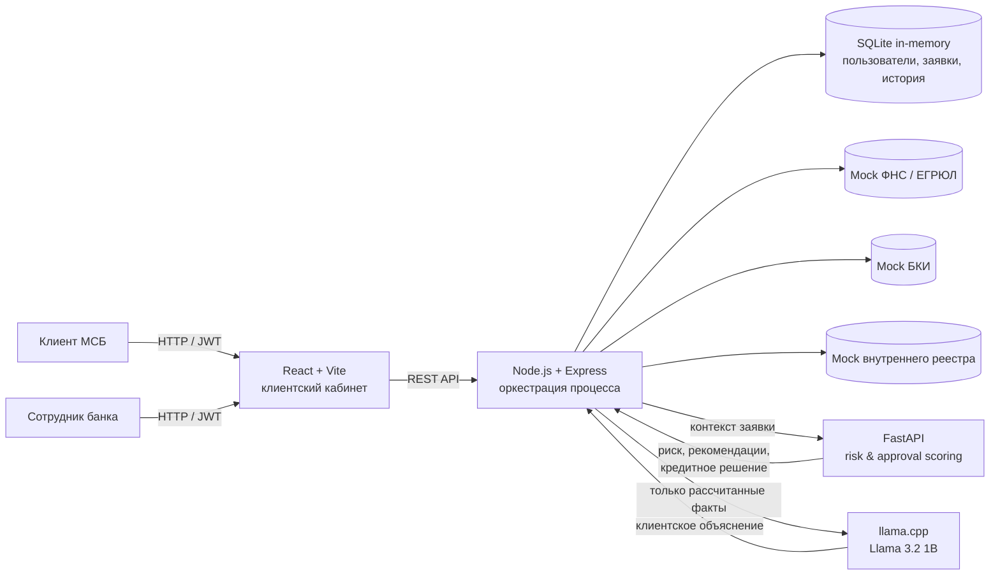
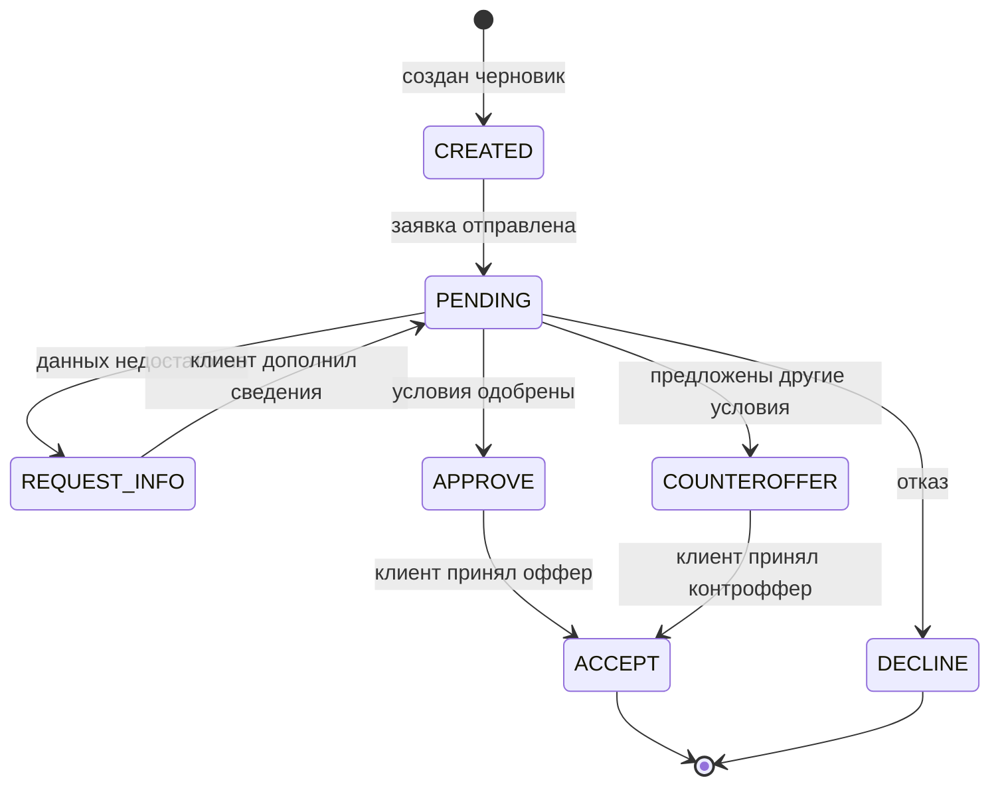
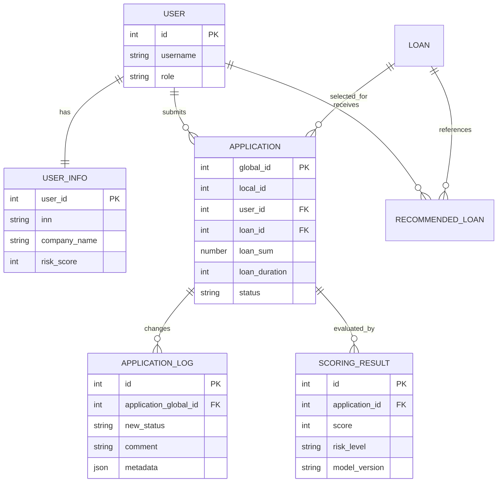

# Alfa Business Credit Flow

Прототип цифрового кредитного конвейера для малого и микробизнеса, подготовленный для хакатона Альфа-Банка 2026.

Решение объединяет клиентский путь и внутреннюю обработку заявки: предприниматель описывает потребность в финансировании, получает подходящие продукты, отправляет заявку и отслеживает её состояние; банк обогащает данные, оценивает риск и формирует одно из четырёх решений — одобрение, встречное предложение, запрос сведений или отказ.

> Статус проекта: **P0 MVP готов**. Клиентский и сотруднический кабинеты, единый кредитный конвейер, scoring, синтетические источники, OpenAPI, E2E integration-test и Docker Compose связаны в один воспроизводимый сценарий.

## Содержание

- [Что требуется решить](#что-требуется-решить)
- [Концепция продукта](#концепция-продукта)
- [Что реализовано](#что-реализовано)
- [Архитектура](#архитектура)
- [Кредитный процесс](#кредитный-процесс)
- [Скоринг и принятие решения](#скоринг-и-принятие-решения)
- [Технологии](#технологии)
- [Быстрый запуск](#быстрый-запуск)
- [Тестовые учётные записи](#тестовые-учётные-записи)
- [Сценарий проверки](#сценарий-проверки)
- [API](#api)
- [Данные и интеграции](#данные-и-интеграции)
- [Тестирование](#тестирование)
- [Ограничения MVP](#ограничения-mvp)
- [Что завершить до дедлайна](#что-завершить-до-дедлайна)
- [Рекомендации команде](#рекомендации-команде)

## Что требуется решить

Задача хакатона — не просто сделать форму кредитной заявки. Необходимо показать **единый управляемый процесс** от возникновения потребности клиента до результата по заявке.

Минимально убедительное решение должно доказать пять вещей:

1. Клиент без банковской экспертизы понимает, какой продукт подходит его задаче.
2. Введённые данные сохраняются и не запрашиваются повторно без причины.
3. Заявка проходит прозрачные этапы, а клиент видит статус и следующее действие.
4. Банк получает данные из нескольких источников, оценивает риск и может обработать нестандартный случай.
5. Эксперт способен воспроизводимо запустить систему и самостоятельно пройти сквозной сценарий.

Для MVP не требуется воспроизводить весь промышленный банковский процесс. Важно реализовать небольшой, но связный контур и честно обозначить смоделированные интеграции, ограничения и дальнейшее развитие.

## Концепция продукта

### Проблема клиента

Предприниматель знает бизнес-задачу — например, нужно пополнить оборотные средства или купить оборудование, — но не обязан понимать продуктовую линейку банка и внутреннюю логику кредитования. Разрозненные анкеты, повторный ввод сведений и непрозрачный статус увеличивают число незавершённых заявок.

### Проблема банка

Банку необходимо одинаково обрабатывать большой поток заявок, собирать сведения из внутренних и внешних источников, объяснимо оценивать риск, автоматически решать типовые случаи и передавать спорные ситуации сотруднику без потери контекста.

### Предлагаемое решение

Alfa Business Credit Flow строится вокруг одной заявки и одного набора данных:

- клиент указывает цель, сумму, срок и ИНН;
- система проверяет компанию и автоматически подбирает подходящие продукты;
- скоринг рассчитывает риск, предварительный лимит, платёж и вероятность одобрения;
- локальная LLM переводит только уже рассчитанные факты в понятное объяснение;
- заявка и история её статусов доступны участникам процесса;
- кредитная политика возвращает `APPROVE`, `COUNTEROFFER`, `REQUEST_INFO` или `DECLINE`;
- клиент видит результат, дополняет сведения или принимает предложение.

Ключевой принцип: **числовое решение принимает детерминированная и версионируемая модель, а LLM не влияет на одобрение кредита**.

## Что реализовано

| Возможность | Статус | Где реализовано |
|---|---:|---|
| JWT-аутентификация и роли `CLIENT` / `EMPLOYEE` | ✅ | Node.js backend |
| Личный кабинет клиента | ✅ | React frontend |
| Каталог кредитных продуктов | ✅ | Backend + frontend |
| Умный подбор по цели, сумме, сроку и данным бизнеса | ✅ | Backend + scoring |
| Проверка ИНН по синтетическому реестру ФНС | ✅ | Mock integration |
| Обогащение данными ФНС, БКИ и внутреннего реестра | ✅ | Backend |
| Детерминированная оценка риска и продуктового соответствия | ✅ | Python scoring service |
| Объяснимые факторы, предупреждения и стоп-факторы | ✅ | Python scoring service |
| Локальное LLM-объяснение рекомендаций | ✅ | llama.cpp + Llama 3.2 1B |
| Создание заявки, просмотр карточки и истории статусов | ✅ | Frontend + backend |
| Запрос и дозаполнение недостающих данных | ✅ | Уточнение возвращает заявку в оркестратор и создаёт новую версию scoring |
| Одобрение, контроффер и отказ | ✅ | Единый contract backend/scoring + UI сотрудника |
| Кабинет сотрудника банка | ✅ | Очередь, фильтры, карточка, факторы, история и решения |
| Персональная новостная лента | 🟡 | Базовые данные и компоненты есть; нужна продуктовая доработка |
| Постоянное хранилище | ❌ | Сейчас используется SQLite in-memory |

## Архитектура



### Ответственность компонентов

| Компонент | Ответственность | Порт |
|---|---|---:|
| `frontend` | вход, дашборд клиента, подбор продукта, карточка и таймлайн заявки | `5173` |
| `backend` | аутентификация, роли, заявки, продукты, история, интеграции и оркестрация | `5003` |
| `scoring` | валидация, признаки, риск-скоринг, продуктовый скоринг и policy decision | `8000` |
| `llm` | понятное текстовое объяснение уже рассчитанной рекомендации | `8081` |

## Кредитный процесс

### Границы MVP

Процесс начинается с выбора потребности в финансировании и заканчивается решением банка и принятием предложения клиентом. Подписание юридических документов, выдача денег, мониторинг после выдачи, взыскание и бухгалтерский учёт в MVP не входят; выдача после принятия оффера считается смоделированной.

### Участники

- **Клиент** — выбирает потребность, подаёт заявку, дополняет сведения, отслеживает статус и принимает предложение.
- **Система** — валидирует, обогащает данные, рассчитывает риск, ведёт историю и формирует рекомендации.
- **Сотрудник банка** — рассматривает пограничные случаи, запрашивает сведения и подтверждает решение.
- **Технический ML-пользователь** — передаёт автоматическое решение scoring-сервиса в backend с ролевой авторизацией.

### Состояния заявки

Текущие backend-статусы прототипа: `CREATED`, `PENDING`, `REQUEST_INFO`, `COUNTEROFFER`, `APPROVE`, `DECLINE`, `ACCEPT`.



Перед финальной сдачей следует унифицировать эти значения с именами во frontend (`APPROVED`, `DECLINED`, `COMPLETED`) и закрепить переходы одной state machine на backend, чтобы невозможные переходы отвергались централизованно.

## Скоринг и принятие решения

Сервис не выдаёт сложную эвристическую формулу за обученную ML-модель. Это прозрачный rule-based scorecard, подходящий для демонстрации бизнес-логики и объяснимости на синтетических данных.

### Источники признаков

- ФНС / ЕГРЮЛ: статус, дата регистрации, организационная форма, ОКВЭД и сведения о МСП;
- БКИ: число кредитов, долг, ежемесячный платёж, просрочки и дефолт;
- внутренний контур: обороты, расходы, эквайринг, срок отношений с банком, 115-ФЗ и история продуктов;
- заявка: цель, сумма, срок, заявленная выручка и продукт.

### Логика оценки

1. Входные данные проходят схемную и логическую валидацию.
2. Из источников строятся нормализованные признаки.
3. Risk scorecard формирует балл `0–999`, уровень `LOW` / `MEDIUM` / `HIGH`, факторы и стоп-факторы.
4. Для каждого продукта рассчитываются eligibility, предварительный лимит, платёж, долговая нагрузка и эвристическая вероятность одобрения.
5. Кредитная политика выбирает результат:
   - `DECLINE` — сработал стоп-фактор или риск вне политики;
   - `REQUEST_INFO` — отсутствуют критичные сведения;
   - `APPROVE` — низкий риск и вероятность не ниже `0.75`;
   - `COUNTEROFFER` — риск не высокий и вероятность не ниже `0.40`, но условия корректируются лимитом.

Конфигурации версионируются отдельно:

- `ml/artifacts/risk_scorecard_v1.json` — `risk_scorecard_v1.0.0`;
- `ml/artifacts/approval_policy_v1.json` — `approval_rules_v1.0.0`.

> `default_probability` и `approval_probability` являются демонстрационными эвристиками, не откалиброваны на реальном кредитном портфеле и не предназначены для промышленного кредитного решения.

## Технологии

- **Frontend:** React 19, React Router 7, Vite 8, Nginx.
- **Backend:** Node.js 24, Express 4, JWT, bcryptjs, встроенный `node:sqlite`.
- **Scoring:** Python 3.11, FastAPI, Uvicorn, dataclasses, pytest/unittest.
- **LLM:** llama.cpp server, `Llama-3.2-1B-Instruct-Q4_K_M.gguf`, CPU-only режим.
- **Инфраструктура:** Docker, Docker Compose.

Версии npm-зависимостей зафиксированы в `package-lock.json`, `backend/package-lock.json` и `frontend/package-lock.json`. Python-диапазоны зафиксированы в `ml/pyproject.toml`; перед сдачей рекомендуется дополнительно добавить lock-файл с точными версиями.

## Быстрый запуск

### Требования

- Docker Desktop с Docker Compose v2;
- не менее 4 ГБ свободной оперативной памяти;
- свободные порты `5173`, `5003`, `8000`, `8081`;
- около 1 ГБ места для GGUF-модели.

### 1. Подготовить окружение

Из корня репозитория:

```powershell
Copy-Item .env.example .env
```

Для локального демо значения из `.env.example` можно оставить без изменений. Для публикации обязательно замените `JWT_SECRET` и все пароли.

### 2. Подготовить локальную модель

Ожидаемый путь:

```text
local-llm/models/Llama-3.2-1B-Instruct-Q4_K_M.gguf
```

Если файла нет:

```powershell
New-Item -ItemType Directory -Force local-llm/models
curl.exe -L --fail --output local-llm/models/Llama-3.2-1B-Instruct-Q4_K_M.gguf "https://huggingface.co/bartowski/Llama-3.2-1B-Instruct-GGUF/resolve/main/Llama-3.2-1B-Instruct-Q4_K_M.gguf?download=true"
```

Модель монтируется в контейнер только для чтения и не копируется в Docker image.

### 3. Запустить все сервисы

```powershell
docker compose up --build
```

После успешного health-check откройте:

- интерфейс: <http://localhost:5173/#/login>;
- backend health-check: <http://localhost:5003/api/health>;
- Swagger scoring-сервиса: <http://localhost:8000/docs>;
- health-check scoring-сервиса: <http://localhost:8000/health>.

Полезные команды:

```powershell
docker compose ps
docker compose logs -f backend scoring llm
docker compose down
```

Используйте корневой `compose.yaml`. Файл `backend/docker-compose.yaml` является устаревшей заглушкой и не предназначен для запуска проекта.

### Запуск без Docker

Потребуются Node.js 24, Python 3.11 и четыре PowerShell-терминала.

```powershell
# Терминал 1 — LLM
.\local-llm\start.ps1
```

```powershell
# Терминал 2 — scoring
cd ml
py -m venv .venv
.\.venv\Scripts\python.exe -m pip install -e .
.\.venv\Scripts\python.exe -m uvicorn credit_scoring.main:app --host 127.0.0.1 --port 8000 --env-file ..\.env
```

```powershell
# Терминал 3 — backend
cd backend
npm ci
npm run dev
```

```powershell
# Терминал 4 — frontend
cd frontend
npm ci
$env:VITE_LOCAL_API_URL='http://localhost:5003'
npm run dev -- --host 127.0.0.1 --port 5173
```

Открывайте frontend через `localhost`, а не `127.0.0.1`: текущая CORS-конфигурация backend разрешает origin `http://localhost:5173`.

## Конфигурация

| Переменная | Назначение | Пример для локального запуска |
|---|---|---|
| `JWT_SECRET` | подпись JWT | `your_jwt_secret_key` |
| `ML_PASSWORD` | пароль технического пользователя scoring | `12345678` |
| `EMPLOYEE_PASSWORD` | пароль сотрудника банка | `12345678` |
| `CLIENT_PASSWORD1..4` | пароли синтетических клиентов | `12345678` |
| `SCORING_URL` | URL scoring для backend | `http://scoring:8000` |
| `BACKEND_URL` | URL backend для scoring | `http://backend:5003/api` |
| `LLM_BASE_URL` | URL llama.cpp | `http://llm:8080` |
| `LLM_MODEL` | отображаемое имя модели | `Llama-3.2-1B-Instruct-Q4_K_M` |
| `LLM_TIMEOUT_MS` | тайм-аут генерации | `30000` |
| `VITE_LOCAL_API_URL` | URL backend, встраиваемый во frontend | `http://localhost:5003` |

## Тестовые учётные записи

После старта backend автоматически заполняет синтетические реестры и запускает демонстрационную активность. Подождите завершения сообщений `СИМУЛЯЦИЯ ЗАВЕРШЕНА` в логах backend.

При стандартном `.env.example` пароль всех аккаунтов — `12345678`.

| Логин | ИНН | Профиль | Ожидаемое поведение |
|---|---|---|---|
| `ivanov` | `7700000001` | устойчивый бизнес, хорошая история | низкий риск / одобрение |
| `petrov` | `7700000002` | отрицательный cash flow, 115-ФЗ | стоп-фактор / отказ |
| `sidorov` | `7700000003` | средний профиль | уточнение или изменённые условия |
| `novikov` | `7700000004` | новый клиент, неполные данные | запрос дополнительных сведений |
| `employee` | — | сотрудник банка | доступ к bank API; UI кабинета не завершён |

Синтетические данные специально покрывают положительный, отрицательный, пограничный и неполный профили. Они не относятся к реальным физическим лицам или компаниям.

## Сценарий проверки

### Клиентский сценарий

1. Запустите систему и дождитесь завершения инициализации.
2. Откройте <http://localhost:5173/#/login>.
3. Войдите как `ivanov` / `12345678`.
4. На главной странице проверьте список заявок, статусы и предложения.
5. Откройте «Подобрать финансирование».
6. Выберите цель, например «Пополнение оборотных средств».
7. Укажите сумму, срок и ИНН `7700000001`.
8. Сравните предложения: лимит, ставку, платёж, вероятность, позитивные факторы и предупреждения.
9. Отправьте заявку и откройте её карточку.
10. Проверьте таймлайн и динамическое состояние заявки.

### Проверка разных исходов

- `ivanov` демонстрирует сильный профиль;
- `petrov` демонстрирует объяснимый отказ по стоп-фактору;
- `sidorov` демонстрирует пограничный сценарий;
- `novikov` демонстрирует запрос данных и повторное рассмотрение.

### Проверка scoring API без интерфейса

После запуска откройте <http://localhost:8000/docs> и выполните `POST /v1/evaluate` с телом из `ml/data/sample_request.json`.

Ожидается структурированный ответ с блоками:

- `risk` — балл, уровень, вероятность дефолта, факторы и версия модели;
- `recommendations` — соответствие продукту, лимит, платёж, вероятность и причины;
- `decision` — итог policy, если передан конкретный продукт;
- `validation_warnings` — некритичные проблемы качества данных.

## API

Все backend-маршруты имеют префикс `/api`.

### Публичные

| Метод | Маршрут | Назначение |
|---|---|---|
| `GET` | `/health` | состояние backend |
| `POST` | `/auth/register` | регистрация клиента |
| `POST` | `/auth/login` | вход и получение JWT |
| `GET` | `/products` | каталог продуктов |
| `GET` | `/mocks/fns/:inn` | синтетическая проверка компании |
| `GET` | `/mocks/bki/:inn` | синтетические сведения БКИ |

### Клиент, роль `CLIENT`

| Метод | Маршрут | Назначение |
|---|---|---|
| `GET` | `/client/dashboard` | профиль, заявки, последние события и предложения |
| `POST` | `/recommendations/products` | умный подбор продуктов |
| `GET` | `/applications` | заявки текущего клиента |
| `POST` | `/applications` | создать заявку |
| `GET` | `/applications/:localId` | карточка собственной заявки |
| `GET` | `/applications/:localId/history` | история статусов |
| `POST` | `/applications/:localId/submit` | отправить заявку |
| `POST` | `/applications/:localId/clarify` | дополнить отсутствующие данные |
| `POST` | `/applications/:localId/acceptOffer` | принять предложение |

### Сотрудник, роль `EMPLOYEE`

| Метод | Маршрут | Назначение |
|---|---|---|
| `GET` | `/bank/applications` | очередь всех заявок |
| `GET` | `/bank/applications/:globalId` | карточка заявки |
| `GET` | `/bank/applications/:globalId/history` | история заявки |
| `POST` | `/bank/applications/:globalId/decision` | решение банка |
| `GET` | `/bank/clients/:inn` | агрегированный профиль клиента |

### Scoring service

| Метод | Маршрут | Назначение |
|---|---|---|
| `GET` | `/health` | версии rule-based моделей |
| `POST` | `/v1/evaluate` | оценка риска и подбор продуктов |
| `POST` | `/v1/applications/:id/process` | оценка и отправка решения в backend |

Авторизованные запросы принимают заголовок `Authorization: Bearer <JWT>`.

## Данные и интеграции

### Основные сущности



### Смоделированные интеграции

| Источник | Что используется | Реализация MVP |
|---|---|---|
| ФНС / ЕГРЮЛ / ЕГРИП | регистрация, статус, ОКВЭД, категория МСП | отдельная in-memory SQLite mock DB |
| БКИ | обязательства, платёжная дисциплина, просрочки | отдельная in-memory SQLite mock DB |
| Внутренние системы банка | обороты, эквайринг, 115-ФЗ, история отношений | таблица `registry_internal` |
| Кредитная политика | лимиты, риск и тип решения | версионируемые JSON-конфигурации |
| Генеративная модель | переформулировка фактов для клиента | локальная Llama 3.2 через llama.cpp |

Реальные сетевые вызовы во внешние государственные или кредитные сервисы не выполняются.

## Тестирование

### Unit-тесты scoring

```powershell
cd ml
py -m unittest discover -s tests -v
```

Проверяются, в частности:

- детерминированность результата;
- положительный профиль;
- стоп-фактор 115-ФЗ;
- серьёзная просрочка;
- выход суммы за границы продукта;
- несовпадение ИНН;
- некорректные даты и булевы значения;
- загрузка конфигурации и защита технических credentials.

На момент обновления документации проходят **11 из 11** unit-тестов scoring.

### Frontend

```powershell
cd frontend
npm run lint
npm run build
```

### Рекомендуемый smoke-test перед сдачей

```powershell
docker compose up --build -d
docker compose ps
Invoke-RestMethod http://localhost:5003/api/health
Invoke-RestMethod http://localhost:8000/health
docker compose logs --tail 100 backend scoring llm
```

После smoke-test необходимо вручную пройти четыре синтетических профиля и сохранить скриншоты ключевых состояний.

## Ограничения MVP

- Данные хранятся в памяти и теряются после рестарта backend.
- ФНС, БКИ и внутренние банковские источники смоделированы.
- Вероятности скоринга эвристические и не откалиброваны на реальном портфеле.
- Обработка выполняется синхронно; для промышленной нагрузки потребуется брокер сообщений и фоновые workers.
- Новостная лента пока не формирует полноценный персональный контент.
- Нет промышленного управления согласиями, ПДн, аудитом, секретами и отказоустойчивостью.
- Нет юридического оформления и фактической выдачи средств.

Эти ограничения допустимы для прототипа только при условии, что основной демонстрационный сценарий к сдаче будет полностью связан и воспроизводим.

## Что завершить до дедлайна

### P0 — без этого решение не соответствует обязательной части задания

- [x] Реализовать кабинет сотрудника: очередь, фильтры, карточка клиента, факторы риска, история и кнопки решений.
- [x] Связать `submit → enrichment → scoring → decision → client action` одним оркестрируемым сценарием.
- [x] Унифицировать словарь статусов и action endpoints между frontend, backend и scoring.
- [x] Исправить переход после уточнения данных: вернуть заявку в рассмотрение и повторно запустить scoring.
- [x] Сделать основной E2E-сценарий устойчивым без зависимости от фиксированных `global_id`.
- [x] Добавить OpenAPI для backend и сохранить спецификацию в репозитории.
- [x] Добавить HTTP-коллекцию с готовыми запросами.
- [x] Добавить отдельные архитектурную схему, диаграмму состояний и модель данных в `docs/`.
- [x] Добавить `THIRD_PARTY_NOTICES.md`: библиотеки, Llama 3.2, GGUF-квантизация, llama.cpp, лицензии, mock-интеграции и происхождение данных.
- [x] Зафиксировать финальную версию тегом `v1.0.0-hackathon` (тег указывает на финальный commit hash).
- [ ] Проверить чистый запуск на другом компьютере только по README.

### P1 — сильнее всего влияет на оценку продукта

- [ ] Сделать персональную новостную ленту: изменение статуса, запрос действия, готовый оффер, объяснение следующего шага.
- [x] Показывать сотруднику «почему»: факторы, источники, свежесть данных, стоп-факторы и версию модели.
- [x] Сохранять исходно запрошенные условия отдельно от одобренных, чтобы корректно показывать контроффер.
- [ ] Добавить идемпотентность решений и строгую state machine.
- [x] Добавить backend integration-тест сквозного пути; браузерный E2E остаётся дальнейшим усилением.
- [ ] Перенести данные в постоянную PostgreSQL/SQLite database volume или явно сделать seed/reset-команду для демо.
- [ ] Поднять публичный стенд по HTTPS и добавить ссылку в начало README.

### P2 — развитие после стабильного MVP

- [ ] Асинхронная обработка заявок и очередь событий.
- [ ] Версионирование анкет и согласий.
- [ ] Мониторинг, трассировка и продуктовая аналитика воронки.
- [ ] A/B-тест объяснений и подсказок.
- [ ] Калибровка скоринга на обезличенной выборке и model monitoring.

## Рекомендации команде

### Как лучше позиционировать решение

Главная история демо должна звучать не как «мы сделали ещё один кредитный калькулятор», а как:

> Мы создали единый контур, в котором клиент формулирует бизнес-потребность простыми словами, система переиспользует доступные данные, объяснимо оценивает варианты, а клиент и банк работают с одной заявкой и общей историей процесса.

Три наиболее сильных продуктовых акцента:

1. **Прозрачность для клиента:** понятный статус и конкретное следующее действие.
2. **Объяснимость для банка:** каждый результат связан с факторами, источниками и версией правил.
3. **Управляемый human-in-the-loop:** автоматика обрабатывает типовые случаи, сотрудник подключается к исключениям.

### Что показать за 5–7 минут

1. Клиент входит и видит персональный дашборд.
2. Указывает цель, сумму и срок без выбора банковского продукта вручную.
3. Система находит компанию, обогащает данные и показывает предложения с объяснениями.
4. Клиент отправляет заявку; статус и лента обновляются.
5. На экране банка видны агрегированные данные, риск и причины.
6. Для неполного профиля банк или policy запрашивает конкретные сведения.
7. После уточнения заявка пересчитывается и превращается в одобрение либо контроффер.
8. Клиент принимает предложение; процесс завершается.

Не тратьте демо на регистрацию, технические логи или перечисление библиотек. Сначала покажите пользовательскую ценность, затем за 30–60 секунд объясните архитектуру и роль AI.

### Разделение работы команды

| Роль | Главный результат до сдачи |
|---|---|
| Frontend-разработчик | завершить кабинет банка, ленту, статусы, действия и polished demo path |
| Backend-разработчик | единая state machine, оркестрация scoring, постоянство данных, OpenAPI и integration tests |
| ML-инженер | согласовать признаки и policy, сохранять результаты scoring, объяснения и версии, подготовить model card |

Работать лучше вертикальными срезами, а не тремя изолированными слоями: сначала полностью довести один путь `заявка → решение → отображение`, затем расширять варианты.

### Критерии готовности

Решение можно считать готовым к сдаче, если на чистом компьютере эксперт за 10–15 минут способен:

- поднять все сервисы одной командой;
- войти готовым тестовым аккаунтом;
- пройти минимум один полный клиентский сценарий;
- увидеть изменение статуса и ленты;
- получить объяснимое решение банка;
- открыть Swagger и тестовую коллекцию;
- сопоставить поведение с архитектурой, state diagram и моделью данных;
- определить точную проверяемую версию по тегу и commit hash.

## Структура репозитория

```text
.
├── frontend/                 # React UI
├── backend/                  # Express API, процесс и mock-реестры
│   ├── mockDatabase/         # синтетические ФНС и БКИ
│   └── src/
├── ml/                       # FastAPI scoring service
│   ├── artifacts/            # версии scorecard и policy
│   ├── data/                 # пример запроса
│   ├── src/credit_scoring/   # признаки, risk, approval, decision
│   └── tests/
├── local-llm/                # запуск llama.cpp и инструкция по модели
├── compose.yaml              # единый запуск сервисов
├── .env.example              # шаблон конфигурации
└── README.md
```

## Версия решения

Документ подготовлен на базе commit `ea44004`. Перед дедлайном замените эту строку на финальный commit hash и добавьте неизменяемый git tag. Коммиты после дедлайна, согласно условиям хакатона, не учитываются.

## Безопасность и правовой статус

Проект является демонстрационным прототипом. Он использует синтетические данные, локальную модель и смоделированные внешние интеграции. Решение не предназначено для обработки реальных персональных данных, промышленной оценки кредитоспособности или автоматического принятия юридически значимых решений без дополнительных мер безопасности, валидации, аудита и соответствия требованиям банка.
