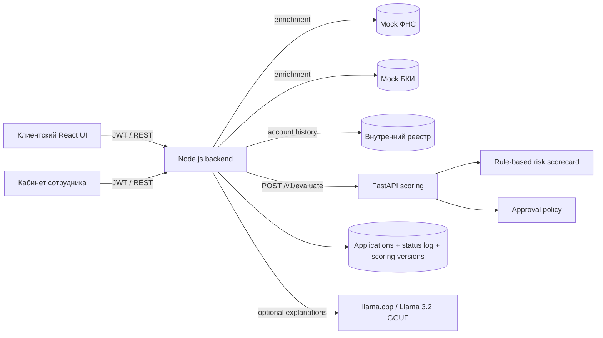

# Архитектура решения

Backend является оркестратором и владельцем состояния заявки. При отправке или уточнении он последовательно фиксирует статусы, собирает данные из трёх источников, вызывает scoring и сохраняет полную версию результата. Scoring не меняет состояние заявки напрямую: он возвращает риск, факторы и решение по контракту `APPROVE | COUNTEROFFER | REQUEST_INFO | DECLINE`.

Если scoring недоступен, заявка не теряется: backend переводит её в `UNDER_REVIEW` и сохраняет техническую причину в истории. Сотрудник может принять ручное решение или повторить scoring из карточки.

## Границы доступа

- `CLIENT` видит только заявки своего `user_id` и использует локальный номер `local_id`.
- `EMPLOYEE` работает с общей очередью и стабильным `global_id`.
- Все приватные маршруты используют JWT и проверку роли.
- Mock ФНС/БКИ и in-memory SQLite предназначены только для демонстрации; для production нужны внешние адаптеры и персистентная БД.

Контракт REST зафиксирован в [`backend/openapi.yaml`](../backend/openapi.yaml), а исполняемые примеры — в [`api.http`](../api.http).
