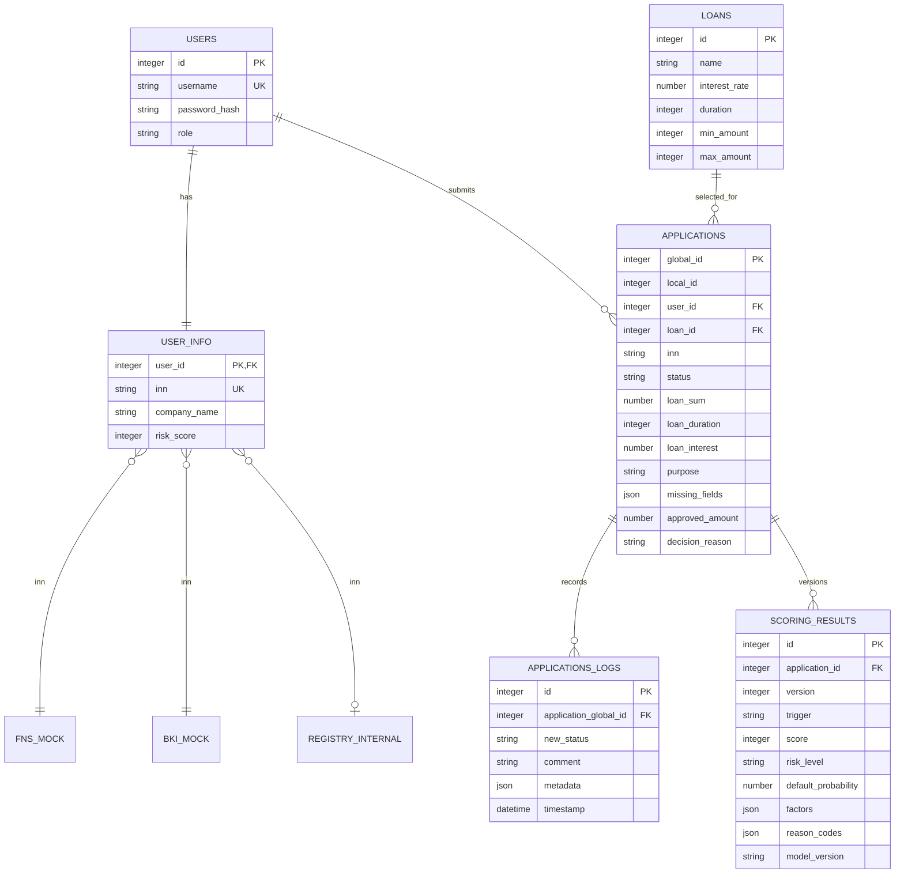

# Модель данных

`global_id` — технический идентификатор общей очереди, `local_id` — последовательный номер внутри одного клиента. Уникальность прикладной ссылки обеспечивается парой `(user_id, local_id)`; E2E и HTTP-коллекция всегда получают оба ID из ответа создания заявки и не предполагают фиксированных значений.

Поля JSON сейчас хранятся как `TEXT` из-за демонстрационной in-memory SQLite. В production-схеме их следует перенести в JSONB и добавить ограничения уникальности `(user_id, local_id)` и `(application_id, version)`.
