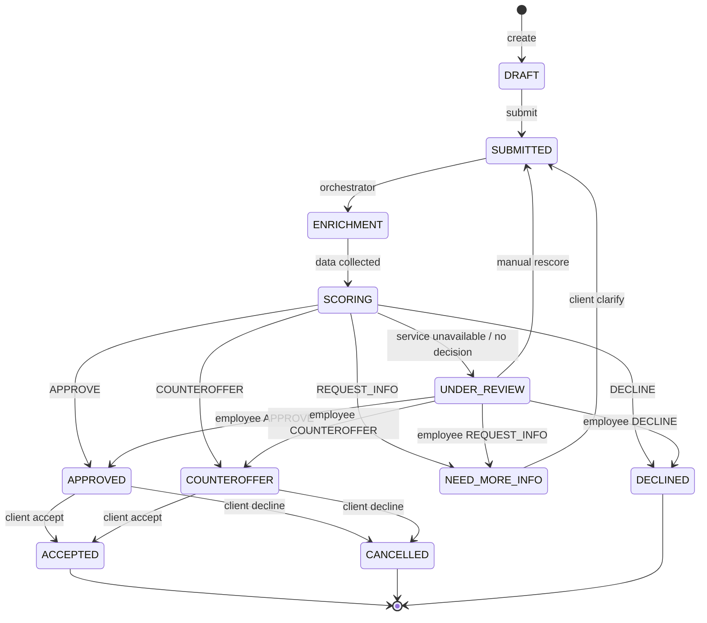

# Диаграмма состояний заявки

## Канонический словарь

| Слой | Значения |
|---|---|
| Статусы заявки | `DRAFT`, `SUBMITTED`, `ENRICHMENT`, `SCORING`, `UNDER_REVIEW`, `NEED_MORE_INFO`, `APPROVED`, `COUNTEROFFER`, `DECLINED`, `ACCEPTED`, `CANCELLED` |
| Решения scoring/сотрудника | `APPROVE`, `COUNTEROFFER`, `REQUEST_INFO`, `DECLINE` |
| Действия клиента | `POST /applications/{localId}/accept`, `POST /applications/{localId}/decline`, `POST /applications/{localId}/clarify` |

Каждый переход статуса автоматически создаёт строку в `applications_logs`. Повторный scoring не перезаписывает старый результат, а создаёт следующую версию в `scoring_results` с trigger `CLARIFICATION` или `MANUAL_REVIEW`.
